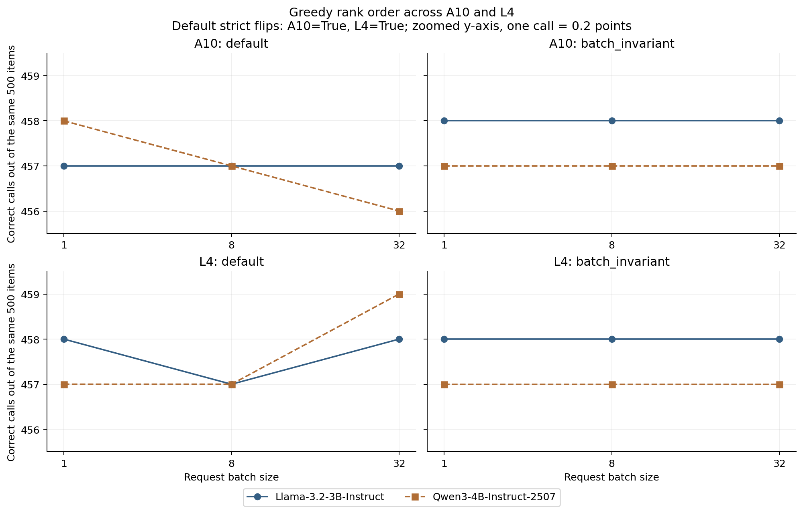
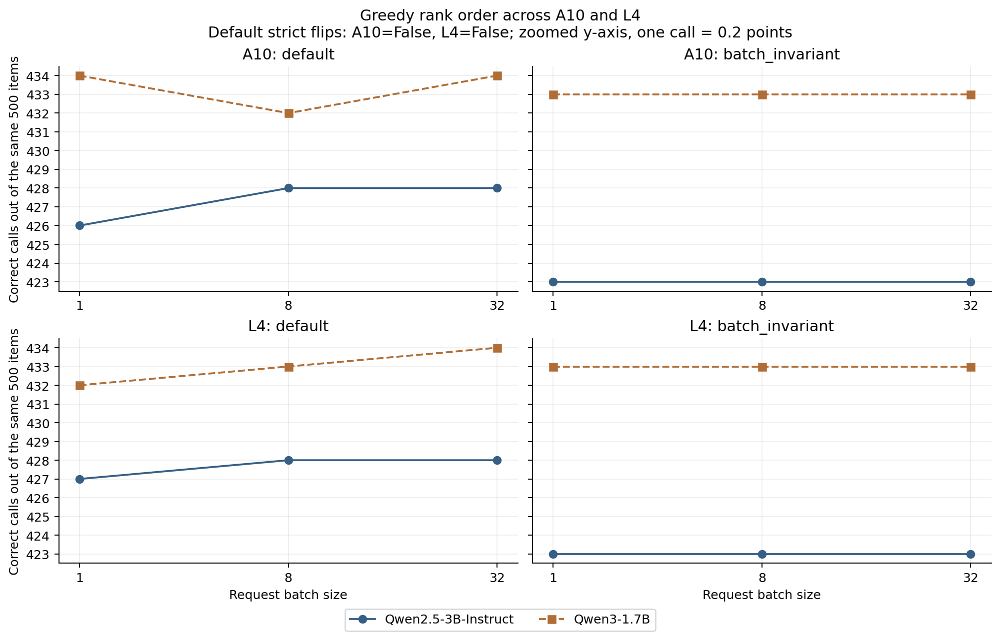
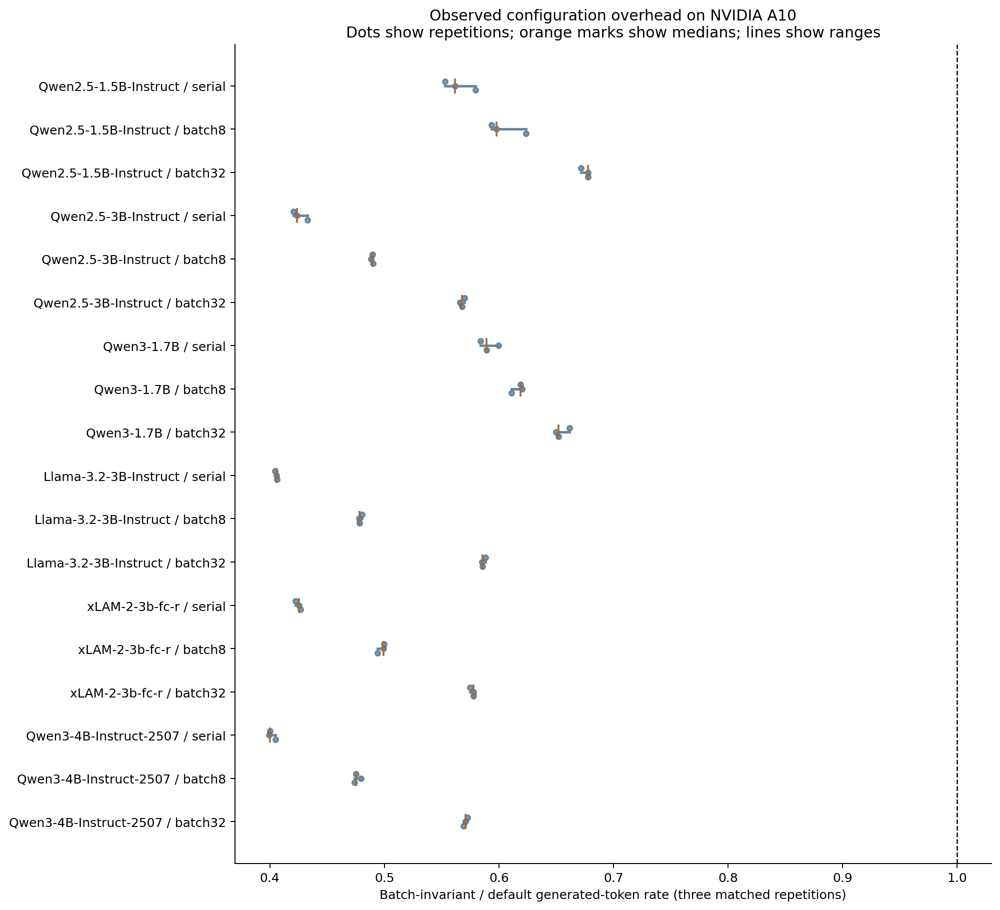
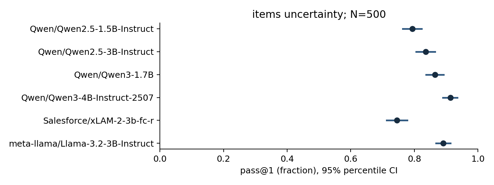

# Batching changes 2–5% of greedy answers; a one-item lead can swap ranks

Batch size changed about 2–5% of greedy answers. For the near-tied Llama3B/Qwen3-4B pair, the observed flip was a one-item margin out of 500, within exploratory paired 95% intervals of roughly ±3 percentage points. The separate sampling analysis projects roughly 800–1,100 items to resolve a 3-point gap, with ten sampled answers per item per model.

Under batch invariance, decoded outputs were identical across A10 and L4 for all four replicated models. Switching to invariance can itself change the winner: at A10 batch 1, the lead moves from Qwen3-4B to Llama3B. Median token throughput was 32–60% lower in the repeated A10 timing study.

This article combines the six-model A10 study and the four-model L4 replication, completed October 29, 2026. It presents measurement and mitigation on small open models, with the reusable `evalnoise` CLI. The [combined numerical report](../results/REPORT.md) retains every A10 pair, paired score-difference intervals, physical GPU assignments, and accounting. Frozen per-session artifacts remain the provenance record. This merge adds no inference.

<!-- results:start -->
## Which model ranks higher at each default batch size?

Every count is correct calls out of the same 500 items. Higher rank means a higher observed score, not established population superiority. Batch size is controlled offline request submission, with the engine limit fixed at 64 sequences.

| Pair, A vs B | GPU | Default batch | A correct / 500 | B correct / 500 | Higher rank |
|---|---|---|---|---|---|
| Llama-3.2-3B-Instruct vs Qwen3-4B-Instruct-2507 | A10 | 1 | 457 | 458 | Qwen3-4B-Instruct-2507 |
| Llama-3.2-3B-Instruct vs Qwen3-4B-Instruct-2507 | A10 | 8 | 457 | 457 | Tie |
| Llama-3.2-3B-Instruct vs Qwen3-4B-Instruct-2507 | A10 | 32 | 457 | 456 | Llama-3.2-3B-Instruct |
| Llama-3.2-3B-Instruct vs Qwen3-4B-Instruct-2507 | L4 | 1 | 458 | 457 | Llama-3.2-3B-Instruct |
| Llama-3.2-3B-Instruct vs Qwen3-4B-Instruct-2507 | L4 | 8 | 457 | 457 | Tie |
| Llama-3.2-3B-Instruct vs Qwen3-4B-Instruct-2507 | L4 | 32 | 458 | 459 | Qwen3-4B-Instruct-2507 |
| Qwen2.5-3B-Instruct vs Qwen3-1.7B | A10 | 1 | 426 | 434 | Qwen3-1.7B |
| Qwen2.5-3B-Instruct vs Qwen3-1.7B | A10 | 8 | 428 | 432 | Qwen3-1.7B |
| Qwen2.5-3B-Instruct vs Qwen3-1.7B | A10 | 32 | 428 | 434 | Qwen3-1.7B |
| Qwen2.5-3B-Instruct vs Qwen3-1.7B | L4 | 1 | 427 | 432 | Qwen3-1.7B |
| Qwen2.5-3B-Instruct vs Qwen3-1.7B | L4 | 8 | 428 | 433 | Qwen3-1.7B |
| Qwen2.5-3B-Instruct vs Qwen3-1.7B | L4 | 32 | 428 | 434 | Qwen3-1.7B |

On A10, Qwen3-4B ranks above Llama3B at batch 1, they tie at batch 8, and Llama3B ranks above Qwen3-4B at batch 32. On L4, Llama3B ranks above Qwen3-4B at batch 1, they tie at batch 8, and Qwen3-4B ranks above Llama3B at batch 32. Thus the strict full-set flip reproduces, but the winner at each untied setting reverses between GPUs.

Qwen3-1.7B ranks above Qwen2.5-3B at every default batch size on both GPUs. A near tie does not require a flip.





Both figures zoom the vertical axis. One correct call equals 0.2 percentage points.

## Batch invariance removes the observed batch dependence

| Pair, A vs B | GPU | Invariant A, batches 1 / 8 / 32 | Invariant B, batches 1 / 8 / 32 | Higher at every batch |
|---|---|---|---|---|
| Llama-3.2-3B-Instruct vs Qwen3-4B-Instruct-2507 | A10 | 458 / 458 / 458 | 457 / 457 / 457 | Llama-3.2-3B-Instruct |
| Llama-3.2-3B-Instruct vs Qwen3-4B-Instruct-2507 | L4 | 458 / 458 / 458 | 457 / 457 / 457 | Llama-3.2-3B-Instruct |
| Qwen2.5-3B-Instruct vs Qwen3-1.7B | A10 | 423 / 423 / 423 | 433 / 433 / 433 | Qwen3-1.7B |
| Qwen2.5-3B-Instruct vs Qwen3-1.7B | L4 | 423 / 423 / 423 | 433 / 433 / 433 | Qwen3-1.7B |

Under batch invariance, Llama3B ranks above Qwen3-4B at all three batch sizes on both GPUs. Qwen3-1.7B ranks above Qwen2.5-3B throughout. For all four replicated models, invariant text and correctness match exactly between the recorded A10 and L4 runs.

Across all 15 A10 model pairs, default decoding produced one full-set batch flip and invariant decoding produced none. Across the two L4 comparison pairs, the corresponding counts were one and zero. Changing from default to invariant decoding can itself change a winner at a fixed batch size. Stability is not the same as improved accuracy.

## Bootstrap flips and exploratory uncertainty

A full-set flip requires opposite strict orders at two batch settings on the actual 500 questions. Ties alone do not count. A bootstrap flip fraction asks how often that happens after resampling the questions together across models and batch settings.

| Pair | GPU | Arm | Full-set strict flip | Bootstrap flip fraction [exploratory 95% interval] |
|---|---|---|---|---|
| Llama-3.2-3B-Instruct vs Qwen3-4B-Instruct-2507 | A10 | default | Yes | 8.94% [0.50%, 23.66%] |
| Llama-3.2-3B-Instruct vs Qwen3-4B-Instruct-2507 | A10 | batch_invariant | No | 0.00% [0.00%, 0.00%] |
| Llama-3.2-3B-Instruct vs Qwen3-4B-Instruct-2507 | L4 | default | Yes | 10.28% [1.10%, 27.81%] |
| Llama-3.2-3B-Instruct vs Qwen3-4B-Instruct-2507 | L4 | batch_invariant | No | 0.00% [0.00%, 0.00%] |
| Qwen2.5-3B-Instruct vs Qwen3-1.7B | A10 | default | No | 13.18% [0.60%, 35.80%] |
| Qwen2.5-3B-Instruct vs Qwen3-1.7B | A10 | batch_invariant | No | 0.00% [0.00%, 0.00%] |
| Qwen2.5-3B-Instruct vs Qwen3-1.7B | L4 | default | No | 8.48% [0.70%, 28.45%] |
| Qwen2.5-3B-Instruct vs Qwen3-1.7B | L4 | batch_invariant | No | 0.00% [0.00%, 0.00%] |

All confidence intervals in this article and the combined report are exploratory and unadjusted for multiple comparisons. Flip fractions use 5,000 paired item resamples. Their outer percentile intervals use 500 outer and 1,000 inner draws. The discontinuous ranking statistic and inner Monte Carlo variation limit interpretation. A collapsed [0, 0] interval does not establish that population flips are impossible. Paired score-difference intervals for the close pairs include zero.

The [saved paired comparisons](../results/l4-continuation-20261028T224638Z/pairwise-gpu-comparison.json) retain exploratory score-difference intervals at every batch and separate Monte Carlo precision intervals. A nonzero bootstrap flip fraction can coexist with no observed full-set flip, as the Qwen pair demonstrates.

## The throughput cost was measured on A10

Invariant/default median token-rate ratios range from about 0.400 to 0.678 across 18 A10 configurations, or about 32–60% lower throughput. Each configuration has three matched repetitions on the same 100-item subset, alternating arm order. Table ranges are observed ranges across three trials, not confidence intervals.

| Model on A10 | Batch 1 ratio [observed range] | Batch 8 ratio [observed range] | Batch 32 ratio [observed range] |
|---|---|---|---|
| Qwen2.5-1.5B-Instruct | 0.562 [0.553, 0.580] | 0.598 [0.594, 0.624] | 0.678 [0.672, 0.678] |
| Qwen2.5-3B-Instruct | 0.424 [0.421, 0.433] | 0.490 [0.488, 0.490] | 0.568 [0.566, 0.570] |
| Qwen3-1.7B | 0.589 [0.584, 0.600] | 0.619 [0.611, 0.620] | 0.652 [0.650, 0.662] |
| Llama-3.2-3B-Instruct | 0.406 [0.404, 0.406] | 0.478 [0.478, 0.480] | 0.586 [0.585, 0.588] |
| xLAM-2-3b-fc-r | 0.426 [0.422, 0.427] | 0.499 [0.494, 0.500] | 0.578 [0.575, 0.578] |
| Qwen3-4B-Instruct-2507 | 0.400 [0.399, 0.405] | 0.475 [0.474, 0.480] | 0.571 [0.569, 0.573] |

The timed region includes generation, synchronization, and output collection. Loading, smoke checks, and warmup are excluded from throughput and included in cost. Token counts and completion rates are both retained because output lengths can change. We scored all timing outputs to detect fast failures.

These are configuration measurements without limiter profiling or production tuning. L4 has no repeated throughput study; its generation durations support cost accounting only. The 32–60% cost must not be read as an L4 measurement or a universal vLLM overhead.



## Sampling accuracy remains a separate A10 experiment

Each A10 model has ten sampled completions per item at temperature 0.7, using vLLM's n parameter. Exploratory pass@1 intervals resample whole items. Pass@5 and pass@10 use unbiased point estimators; their exploratory item intervals remain in the saved analysis. L4 adds no stochastic samples.

| Model | A10 pass@1 | Exploratory 95% item-bootstrap interval | Unbiased pass@5 | Unbiased pass@10 |
|---|---|---|---|---|
| Qwen2.5-1.5B-Instruct | 79.36% | [76.36%, 82.30%] | 88.76% | 91.00% |
| Qwen2.5-3B-Instruct | 83.58% | [80.56%, 86.48%] | 89.33% | 91.00% |
| Qwen3-1.7B | 86.48% | [83.72%, 89.16%] | 89.55% | 90.00% |
| Llama-3.2-3B-Instruct | 89.12% | [86.78%, 91.32%] | 94.08% | 95.20% |
| xLAM-2-3b-fc-r | 74.50% | [71.32%, 77.70%] | 84.32% | 87.40% |
| Qwen3-4B-Instruct-2507 | 91.30% | [88.94%, 93.50%] | 94.03% | 95.20% |



The intervals in this sampling figure are exploratory 95% item-bootstrap intervals.

## Text changes and correctness changes

An item changes text if any of its three batch outputs differ. Correctness changes count items whose official BFCL pass/fail result differs. Wilson intervals below are exploratory under an independent-item approximation. Questions recur across models and GPUs, so these observations must not be pooled as independent questions.

| GPU | Model | Default text changes [exploratory Wilson 95% interval] | Invariant text changes [exploratory Wilson 95% interval] | Correctness changes, default / invariant |
|---|---|---|---|---|
| A10 | Qwen2.5-1.5B-Instruct | 13/500, 2.60% [1.53%, 4.40%] | 0/500, 0.00% [0.00%, 0.76%] | 4 / 0 |
| A10 | Qwen2.5-3B-Instruct | 18/500, 3.60% [2.29%, 5.62%] | 0/500, 0.00% [0.00%, 0.76%] | 6 / 0 |
| A10 | Qwen3-1.7B | 13/500, 2.60% [1.53%, 4.40%] | 0/500, 0.00% [0.00%, 0.76%] | 6 / 0 |
| A10 | Llama-3.2-3B-Instruct | 10/500, 2.00% [1.09%, 3.64%] | 0/500, 0.00% [0.00%, 0.76%] | 0 / 0 |
| A10 | xLAM-2-3b-fc-r | 20/500, 4.00% [2.60%, 6.10%] | 0/500, 0.00% [0.00%, 0.76%] | 4 / 0 |
| A10 | Qwen3-4B-Instruct-2507 | 11/500, 2.20% [1.23%, 3.90%] | 0/500, 0.00% [0.00%, 0.76%] | 5 / 0 |
| L4 | Llama-3.2-3B-Instruct | 12/500, 2.40% [1.38%, 4.15%] | 0/500, 0.00% [0.00%, 0.76%] | 2 / 0 |
| L4 | Qwen3-4B-Instruct-2507 | 12/500, 2.40% [1.38%, 4.15%] | 0/500, 0.00% [0.00%, 0.76%] | 5 / 0 |
| L4 | Qwen2.5-3B-Instruct | 23/500, 4.60% [3.08%, 6.81%] | 0/500, 0.00% [0.00%, 0.76%] | 8 / 0 |
| L4 | Qwen3-1.7B | 12/500, 2.40% [1.38%, 4.15%] | 0/500, 0.00% [0.00%, 0.76%] | 4 / 0 |

Zero invariant changes on 500 items gives a per-model exploratory Wilson upper bound of about 0.76%. Shared function templates can violate item independence. Stable scores can hide text changes, as Llama's A10 default counts show.

## How much evaluation would a three-point gap need?

These exploratory planning projections use A10 stochastic pass@1 variance estimates, 500 items and ten samples per model, a two-sided 5% test, and 80% power. They are approximations, not guarantees of a significant result.

| Pair | Approximate MDD, percentage points | Items projected for a 3-point gap |
|---|---|---|
| Qwen2.5-3B-Instruct vs Qwen3-1.7B | 4.45 | 1100 |
| Llama-3.2-3B-Instruct vs Qwen3-4B-Instruct-2507 | 3.87 | 834 |

For both close pairs, increasing samples alone at the existing 500 questions cannot reach a three-point target under the estimated variance components. More answers reduce sampling noise but do not remove differences between questions.

## Cost, interruption recovery, and cleanup

| Scope | Forecast USD | Provisional gross metering USD | Conservative estimate USD |
|---|---|---|---|
| A10 remaining-five job | 6.5151 | 5.6008 | 6.3636 |
| A10 six-model study | 7.3310 | 6.3560 | 7.2402 |
| L4 follow-up, both allocations | 3.6089 | 2.7296 | 3.1575 |
| Whole project, including pilot and failed attempts | Multiple approvals | Early attempts not fully attributable | 10.7213 / 12 |

Cost rows overlap: the remaining-five job is part of the A10 study, and both studies are part of the project. Settled invoice actuals are unknown. Gross metering is provisional, attributed by exact app ID, and excludes credit offsets and unrelated qunti-check usage.

The first L4 allocation was preempted after the Llama/Qwen pair completed. Its checkpoints and all 6,000 scored rows were preserved byte for byte. Only the unfinished Qwen pair resumed, on another L4. Failed partial work is charged but not scored or imputed. Post-preemption GPU queue waiting is excluded from resource time. A persistent execution claim prevents platform replay from regenerating outputs, and saved call IDs permit reconnection without job resubmission.

Every requested comparison pair shares a physical GPU within its tier, and each model's arms stay on that card. The A10 anchor used an earlier A10. The two L4 pairs use separate cards after recovery. The complete article/report cohort has 70,800 scored outputs: 58,800 on A10, including 10,800 timing outputs, plus 12,000 greedy L4 outputs. The same 500 items recur throughout. There are 17 A10 length truncations and 913 A10 AST syntax/format failures, and no L4 length truncations. Incorrect outputs remain in the denominator.

All owned study apps are stopped, running owned containers are zero, holds are released, and temporary results volumes were deleted after hash verification. qunti-check was untouched. This editorial merge uses saved artifacts only and launches no compute.

[A10 receipt](../results/study-20261028T065939Z/receipt.json), [combined L4/project receipt](../results/l4-continuation-20261028T224638Z/receipt.json), [budget](../BUDGET.md), and [decisions](../DECISIONS.md) preserve the accounting and operational evidence.
<!-- results:end -->

## Why temperature zero does not settle the measurement

A greedy decoder chooses the next token with the largest computed score. Temperature zero removes deliberate random token sampling. Batch shape can still change how an inference engine performs floating-point calculations. Small numerical differences can change a near-tied token choice, after which generated answers diverge.

Thinking Machines Lab explains the mechanism and mitigation in [Defeating Nondeterminism in LLM Inference](https://thinkingmachines.ai/blog/defeating-nondeterminism-in-llm-inference/). The pinned [vLLM 0.32.0 implementation](https://docs.vllm.ai/en/v0.32.0/features/batch_invariance/) provides `VLLM_BATCH_INVARIANT=1`.

An answer can change while remaining correct. Correctness can change while the same model stays ahead. Our research question concerns the final step: do batch-sensitive outputs change the ranking of small models on the same BFCL questions, and does batch invariance remove the flip at a measured throughput cost?

The statistical foundations are established work. [Madaan et al.](https://arxiv.org/html/2406.10229v1) study benchmark variance, including variation across training runs and checkpoints. [Evan Miller](https://arxiv.org/html/2411.00640v1) develops paired evaluation uncertainty and power analysis. [Sida Wang](https://arxiv.org/html/2512.21326v1) separates prediction and data noise and compares model pairs. Our contribution is a practical small-model replication with frozen checkpoints, official BFCL scoring, explicit cost accounting, and a reusable CLI. We claim no new variance decomposition or determinism mechanism. The [related-work review](../docs/RELATED_WORK.md) distinguishes inference variation from training-seed variation.

## How we selected models and the L4 replication

The initial pilot compared Qwen2.5-0.5B and Qwen2.5-1.5B on 100 questions. Their sampling pass@1 gap was 32 percentage points, too large to make a useful ranking-sensitivity comparison. The A10 study retained Qwen2.5-1.5B as an anchor and added Qwen2.5-3B, Qwen3-1.7B, Llama-3.2-3B, xLAM-2-3B, and Qwen3-4B-Instruct-2507.

The [official BFCL CSV](https://gorilla.cs.berkeley.edu/data_overall.csv), archived before inference, gave non-live AST scores of 82.92%, 82.67%, and 82.96% for Qwen3-1.7B, Llama3B, and xLAM3B. Those scores preselected their three pairwise comparisons. Published FC scores include other configurations, languages, and weighting. Our common-prompting Python subset did not preserve those close gaps.

We retained all 15 A10 comparisons rather than replacing models or questions. Two additional pairs had default serial gaps within three percentage points. Their selection on A10 is exploratory. We selected those same two pairs before collecting L4 outcomes. This temporal distinction matters: L4 replicates two observed-close comparisons, rather than independently discovering another close pair after seeing L4 scores.

The [frozen selection plan](../docs/FULL_STUDY_PLAN.md) records revisions, seed indices, and license evidence. Qwen3-1.7B uses its documented non-thinking switch. Qwen2.5-3B and xLAM have research or noncommercial restrictions; Llama has its community license and acceptable-use policy. We do not redistribute weights.

## What stays fixed, and what differs between GPUs

Both studies use the same 500 frozen BFCL Python single-turn items and the official AST checker from `bfcl-eval==2026.3.23`. These are subset scores, not the official overall leaderboard. The checker parses generated calls; it does not execute generated code.

Each A10 model produces ten completions per item at temperature 0.7 through vLLM's `n` parameter. Distinct request seed blocks avoid sharing a seed stream across unrelated prompts. These outcomes support pass@1, unbiased pass@5 and pass@10, item uncertainty, and planning estimates. L4 collects no additional stochastic answers.

For greedy evaluation, both arms produce one answer per item at request batch sizes 1, 8, and 32. The engine limit stays at 64 sequences. Every process uses pinned vLLM 0.32.0, bfloat16, eager execution, and disabled prefix caching. The replicated rows match their A10 checkpoint revisions, message and rendered-prompt hashes, seeds, inference package versions, and engine settings. Five-request smoke gates precede generation.

Before Llama's first A10 generation, a tokenization preflight found that its rendered chat already contains the beginning-of-sequence token. We disabled duplicate insertion. Other models' prompt token IDs were unchanged across all 500 questions. The correction remains in both studies, with source snapshots and validation receipts.

The first A10 allocation completed the anchor model before an infrastructure interruption. The other five models, including both close pairs, shared a second physical A10. The L4 primary pair completed before preemption; the unfinished Qwen pair then used a second L4. Each requested pair and each model's arms share one physical card within a GPU tier. UUIDs remain in the combined report.

GPU architecture is not causally isolated. The L4 workers request and cap two CPU cores; A10 requested two and capped four. Hosts, regions, and drivers differ. A10's default process generated stochastic samples before greedy evaluation, while L4 begins greedy evaluation after smoke and the same per-condition warmup. The result establishes sensitivity on these recorded setups, not behavior on every A10, L4, or serving schedule.

## How to read the exploratory intervals

The item bootstrap draws question IDs with replacement and keeps each selected question's model outputs and batch settings together. This pairing preserves the relationship between models on the same question. It avoids treating ten answers to one question as ten independent questions.

A bootstrap win fraction is the share of draws in which a model has the higher score. Ties are separate. A batch-flip fraction counts draws with opposite strict orders at two batch sizes. These are empirical resampling fractions, not posterior probabilities of intrinsic model superiority.

A Monte Carlo precision interval describes numerical precision conditional on the observed dataset. It does not account for a different set of questions. Outer bootstrap intervals address that second source of uncertainty, but ranking is discontinuous at ties and the empirical data may omit relevant patterns. We label all confidence intervals exploratory, including sampling and Wilson intervals, and make no simultaneous or guaranteed-coverage claim. A collapsed zero interval does not prove an event is impossible.

Wilson text-change intervals assume independent items. Shared function templates can violate that assumption. The per-item artifacts support checking another dependence model without regenerating answers. Null ranking results remain reported alongside changed text and correctness.

## Using the CLI on another evaluation

`evalnoise` accepts binary outcomes already graded by an evaluator. It does not infer correctness from arbitrary text or execute supplied code. The [schema reference](../docs/SCHEMA.md) documents sample rows, aggregate success arrays, nested score fields, and explicit field mappings.

```sh
.venv/bin/evalnoise analyze results.jsonl --k 1 5 10 --output analysis.json
```

Use only values of k supported by the available generations for every item. The [unbiased pass@k estimator](https://arxiv.org/abs/2107.03374) averages the chance that at least one of k candidates succeeds. It assumes independent, identically distributed generations and a way to recognize correctness. Pass@10 does not imply that a user can select the correct answer unaided.

The item bootstrap keeps observed answers for each selected question together. A separate within-item resampling diagnostic conditions on the same questions. Adding the two variances would double-count some uncertainty. Conditional resampling for pass@k above one is diagnostic because finite-repeat bias can be substantial.

The CLI also reports paired win and tie fractions, rank distributions, and approximate minimum detectable differences. Planning subtracts finite-repeat sampling variance from the observed variance of item means. More samples can reduce prediction uncertainty, but cannot remove variation between questions. These are exploratory projections rather than promises of a future significant result.

## Reproduce both documents without new compute

From the `leaderboard-noise` project directory, run:

```sh
.venv/bin/python scripts/write_study_article.py
```

This command reads saved summaries and writes this article, `results/REPORT.md`, and `results/combined-sources.json`. It does not contact Modal, score new outputs, or submit inference. The source manifest records the input hashes and explicit winners at every default GPU/batch configuration. The [README](../README.md) documents installation, while [LEARNING.md](../LEARNING.md) gives the two-minute explanation and interview questions.

Dependencies come from official PyPI with hashes in uv lockfiles. The inference images passed CPU compiler preflights and package audits. Only documented user-approved setuptools advisories with absent attack paths were accepted. [Security](../SECURITY.md), [budget](../BUDGET.md), and [decisions](../DECISIONS.md) retain the evidence.

The study covers the recorded A10 and L4 greedy configurations. It does not measure training-seed sensitivity, other GPU families, native tool APIs, longitudinal provider drift, or executed code benchmarks. Optional HumanEval+ and MBPP+ were not run.
